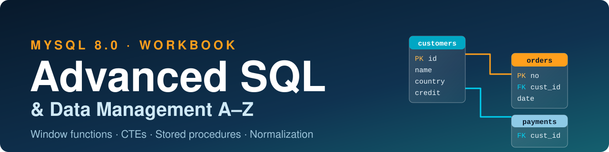
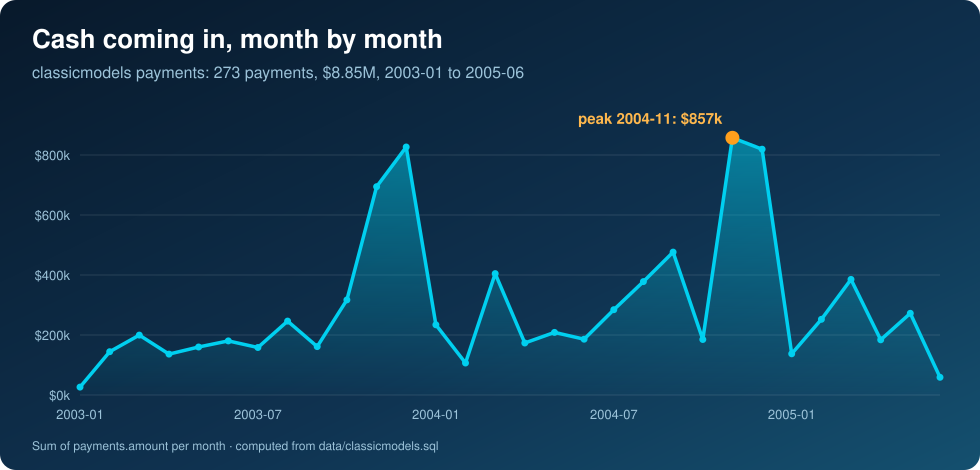
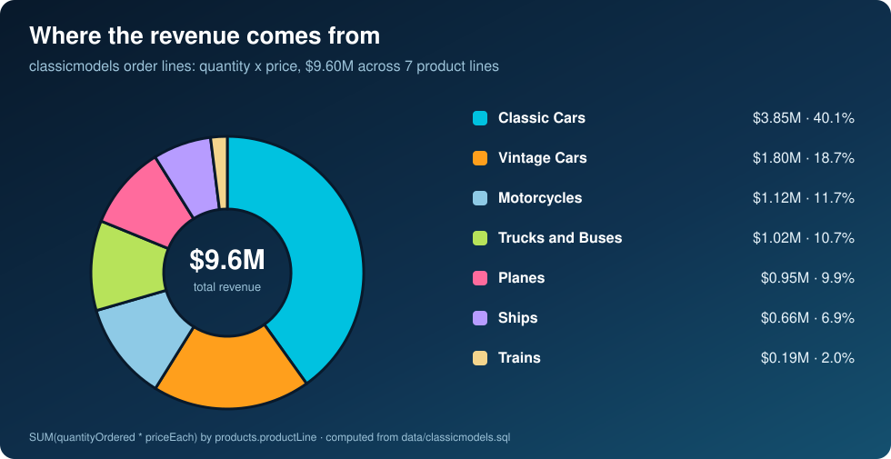

<p align="center">
  <a href="https://dev.mysql.com/doc/refman/8.0/en/"></a>
  <a href="https://www.mysql.com/products/workbench/"></a>
  <a href="https://en.wikipedia.org/wiki/SQL"></a>
  <a href=".github/workflows/sql-run.yml"></a>
  
  
</p>

A hands-on **MySQL workbook in 36 commented SQL scripts**: from `CREATE TABLE` to window functions, pivots and stored procedures, then a database designed from scratch and a customer-analytics project that ends in a machine-learning-ready table. The statements are explained in comments, and every script has been executed against a real MySQL 8.0.

> *"Read the comment, run the statement, check the result: 36 scripts, 2,753 lines of annotated SQL, one sample database."*

---

## Course map

| # | Section | Scripts | What you work on |
|:-:|---------|:-------:|------------------|
| 00 | [Quickstart](00-quickstart/) 🎯 | 1 | CTE + GROUP BY + window function in one query |
| 01 | [SQL Basics](01-sql-basics/) 🧱 | 4 | DDL, DML, DQL, TCL, DCL |
| 02 | [Intermediate SQL](02-intermediate-sql/) 🔧 | 6 | Aggregates, regex, GROUP BY, subqueries, strings |
| 03 | [Advanced SQL](03-advanced-sql/) 🚀 | 8 | Window functions, CTEs, pivot, indexes, views, procedures |
| 04 | [Employee Management Project](04-employee-management-project/) 🏢 | 4 | Design, normal forms, DML, roles |
| 05 | [Final Projects](05-final-projects/) 🏁 | 4 | Customer analytics → ML-ready table |
| 06 | [Advanced SQL Scripts (original)](06-advanced-sql-scripts/) 📜 | 9 | The original flat scripts, incl. JOINs |
| – | [Data](data/) 📂 | 1 dump | the `classicmodels` sample database |
| – | [ER diagrams](docs/er-diagrams/) 🗺️ | 2 | MySQL Workbench models |

---

## Learning path

```
 SQL Basics ──► Intermediate ──────► Advanced ──────────► Employee project ──► Final project
  DDL  DML        aggregates          window functions      design a schema      customer analytics
  DQL  TCL DCL    regex, GROUP BY     CTE, pivot, indexes   normal forms         RFM metrics
                  subqueries          views, procedures     roles, procedures    ML-ready table
```

Sections 2 and 3 work on a ready-made database (`classicmodels`), Section 4 builds a database from nothing, and Section 5 applies everything to answer a real business question.

---

## The sample database at a glance

Most scripts query **`classicmodels`**, a scale-model car retailer: 122 customers in 28 countries, 326 orders and 273 payments for 110 products. The two charts below are computed from [`data/classicmodels.sql`](data/classicmodels.sql).

```
customers.salesRepEmployeeNumber  ->  employees
employees.officeCode  ->  offices
employees.reportsTo  ->  employees
orderdetails.orderNumber  ->  orders
orderdetails.productCode  ->  products
orders.customerNumber  ->  customers
payments.customerNumber  ->  customers
products.productLine  ->  productlines
```



Cash arrives in bursts: the busiest month is November 2004 (about $857k), and a similar pre-holiday spike shows up a year earlier (December 2003, about $827k). This is the kind of question the window-function and CTE scripts answer with `SUM() OVER` and monthly aggregation.



Classic Cars alone bring in about 40% of the revenue, more than the next two product lines combined. The pivot and unpivot scripts reshape exactly this kind of product-by-year sales table.

---

## Script tour

<details>
<summary>🧱 <b>Section 1 — SQL Basics</b> (4 scripts)</summary>

| Script | What it covers |
|---|---|
| [`01-ddl.sql`](01-sql-basics/01-ddl.sql) | DDL: create a database and a table, alter it, drop it |
| [`02-dml-and-dql.sql`](01-sql-basics/02-dml-and-dql.sql) | DDL and DQL walkthrough: tables, indexes, SELECT, WHERE, ORDER BY, JOIN, GROUP BY |
| [`03-dml-and-dql-practice.sql`](01-sql-basics/03-dml-and-dql-practice.sql) | Practice: 50 INSERTs into `company.employees`, then DML and DQL exercises |
| [`04-tcl-and-dcl.sql`](01-sql-basics/04-tcl-and-dcl.sql) | COMMIT, ROLLBACK, GRANT and REVOKE with example users |

</details>

<details>
<summary>🔧 <b>Section 2 — Intermediate SQL</b> (6 scripts)</summary>

| Script | What it covers |
|---|---|
| [`01-aggregate-functions.sql`](02-intermediate-sql/01-aggregate-functions.sql) | Aggregate functions: minimum and maximum payment per customer and more |
| [`02-regexp-practice.sql`](02-intermediate-sql/02-regexp-practice.sql) | Regular expressions with `REGEXP` |
| [`03-group-by-practice.sql`](02-intermediate-sql/03-group-by-practice.sql) | `GROUP BY` practice: ordered quantities per product |
| [`04-subquery.sql`](02-intermediate-sql/04-subquery.sql) | Subqueries on customers and orders |
| [`05-select-design.sql`](02-intermediate-sql/05-select-design.sql) | Designing SELECT queries step by step |
| [`06-string-functions.sql`](02-intermediate-sql/06-string-functions.sql) | String functions on customer data |

</details>

<details>
<summary>🚀 <b>Section 3 — Advanced SQL</b> (8 scripts)</summary>

| Script | What it covers |
|---|---|
| [`01-window-functions.sql`](03-advanced-sql/01-window-functions.sql) | Window functions: `RANK()`, `ROW_NUMBER()` and friends, e.g. credit limit rank within a country |
| [`02-common-table-expressions.sql`](03-advanced-sql/02-common-table-expressions.sql) | Common table expressions (CTE) |
| [`03-pivot.sql`](03-advanced-sql/03-pivot.sql) | Pivot: yearly sales per product as columns (`CASE WHEN`) |
| [`04-unpivot.sql`](03-advanced-sql/04-unpivot.sql) | Unpivot: yearly columns back into rows |
| [`05-index.sql`](03-advanced-sql/05-index.sql) | Indexes and how they speed queries up |
| [`06-query-optimization.sql`](03-advanced-sql/06-query-optimization.sql) | Query optimization techniques |
| [`07-view.sql`](03-advanced-sql/07-view.sql) | Views: the `OrderByCustomer` view |
| [`08-stored-procedures.sql`](03-advanced-sql/08-stored-procedures.sql) | Stored procedures: inserting platinum customers, with `DELIMITER` |

</details>

<details>
<summary>🏢 <b>Section 4 — Employee Management Project</b> (4 scripts)</summary>

| Script | What it covers |
|---|---|
| [`01-database.sql`](04-employee-management-project/01-database.sql) | Create the `employee_management` database and its tables |
| [`02-check-normalization-forms.sql`](04-employee-management-project/02-check-normalization-forms.sql) | Check 1NF, 2NF and 3NF with queries |
| [`03-dml-practice-insert.sql`](04-employee-management-project/03-dml-practice-insert.sql) | INSERT, UPDATE and DELETE practice, with updated phone numbers |
| [`04-full-features.sql`](04-employee-management-project/04-full-features.sql) | Stored procedures, roles and permissions, and more on top of the schema |

</details>

<details>
<summary>🏁 <b>Section 5 — Final Projects</b> (4 scripts)</summary>

| Script | What it covers |
|---|---|
| [`01-part-1.sql`](05-final-projects/01-part-1.sql) | Create the `analysis` schema and `customerbasicinfo` |
| [`02-part-2.sql`](05-final-projects/02-part-2.sql) | RFM table (recency, frequency, monetary) and additional metrics |
| [`03-part-3.sql`](05-final-projects/03-part-3.sql) | Additional metrics and product-line spending per customer |
| [`04-data-prep-for-ml.sql`](05-final-projects/04-data-prep-for-ml.sql) | Join everything into `FINAL_TABLE_FOR_MACHINE_LEARNING` |

</details>

<details>
<summary>📜 <b>Section 6 — Advanced SQL Scripts (original)</b> (9 scripts)</summary>

| Script | What it covers |
|---|---|
| [`01-understanding-joins.sql`](06-advanced-sql-scripts/01-understanding-joins.sql) | Understanding JOINs with a small customer / order example |
| [`02-group-by-subquery-math-string.sql`](06-advanced-sql-scripts/02-group-by-subquery-math-string.sql) | GROUP BY, subqueries, math and string functions |
| [`03-regex-query-flow.sql`](06-advanced-sql-scripts/03-regex-query-flow.sql) | Regular expressions and query flow |
| [`04-pivot-unpivot.sql`](06-advanced-sql-scripts/04-pivot-unpivot.sql) | Pivot and unpivot |
| [`05-indexes.sql`](06-advanced-sql-scripts/05-indexes.sql) | Indexes |
| [`06-query-optimization.sql`](06-advanced-sql-scripts/06-query-optimization.sql) | Query optimization |
| [`07-window-cte-views-stored-procedures.sql`](06-advanced-sql-scripts/07-window-cte-views-stored-procedures.sql) | Window functions, CTEs, views and stored procedures in one script |
| [`08-re-answering-business-questions.sql`](06-advanced-sql-scripts/08-re-answering-business-questions.sql) | Answering business questions with SQL |
| [`09-project.sql`](06-advanced-sql-scripts/09-project.sql) | A small analysis project (customer base info) |

</details>

---

## How to run

1. Install **MySQL 8.0** (and MySQL Workbench if you like a GUI).
2. Load the sample database once: `mysql -u root -p < data/classicmodels.sql`
3. Run the scripts in order, in Workbench (open a file, press the lightning bolt) or with the client: `mysql -u root -p < 02-intermediate-sql/01-aggregate-functions.sql`
4. Sections 4 and 5 continue each other: run `01` first, and the scripts marked ↩️ in the section READMEs expect the tables of earlier scripts.

---

## Repository layout

```
Advanced-SQL-Data-Management-A-Z/
├── 00-quickstart/                    # one self-contained demo query
├── 01-sql-basics/                    # one folder per course section,
├── 02-intermediate-sql/              #   each with its own README
├── 03-advanced-sql/
├── 04-employee-management-project/
├── 05-final-projects/
├── 06-advanced-sql-scripts/          # the original flat scripts
├── data/                             # classicmodels.sql (the sample database)
├── docs/er-diagrams/                 # MySQL Workbench models
├── assets/                           # README banner and charts
└── .github/                          # CI
```

**Why a single `main`?** This repo used to keep every section on its own branch. Everything now lives on `main`, and the original branch history is preserved in the commit graph.

---

## Continuous integration

| Workflow | When | What it does |
|----------|------|--------------|
| [`sql-check.yml`](.github/workflows/sql-check.yml) | every push and pull request | File-name hygiene (no spaces), valid UTF-8, no absolute local paths, and the sample database defines all 8 tables |
| [`sql-run.yml`](.github/workflows/sql-run.yml) | **manual**: Actions → *SQL run on MySQL 8.0 (manual)* → *Run workflow* | Starts MySQL 8.0, loads `classicmodels`, and executes every script from a clean state, writing a pass/fail table to the Job Summary |

Last full run: **35 of 36 scripts pass; 1 is a lecture** (`01-sql-basics/02-dml-and-dql.sql`, see below). The run takes about one minute.

---

## Known limitations

- **Table-name case.** The scripts were written in MySQL Workbench on Windows, where table names are case-insensitive. For example `04-unpivot` creates `SALES_SUMMARY` and then reads `sales_summary`. On a default Linux or macOS server that fails; start the server with `lower_case_table_names=1` (for Docker: `docker run -p 3306:3306 -e MYSQL_ROOT_PASSWORD=root mysql:8.0 --lower-case-table-names=1`). The CI run uses exactly this setting.
- **One lecture, not a runnable script.** `01-sql-basics/02-dml-and-dql.sql` demonstrates DDL and then DQL: its query examples at the end read tables that the script itself dropped above and a `departments` table that is never created, so they error when run top to bottom. It is kept as a reading lecture.
- **Scripts continue each other** in Sections 1, 4 and 5 (see ↩️ in the section READMEs).
- **Privileges.** `03-advanced-sql/08-stored-procedures` and `04-full-features` use `DELIMITER`; `04-full-features` and `01-sql-basics/04-tcl-and-dcl` also create roles or users, so run them with an account that may do that (for example `root`).
- Lines marked `(added: ...)` or `(fixed: ...)` in the scripts are repairs made while restructuring the repo (for example a missing `;`, a stray character, or `IF EXISTS` so a script can be re-run).
- `06-advanced-sql-scripts/` is the first version of the course material and overlaps with Sections 1–5; it is kept because `01-understanding-joins` exists only there.

---

## Tech stack

`MySQL 8.0` · `SQL` · `MySQL Workbench` · `Docker (CI)` · `GitHub Actions`

---

*Built by [Evgenii Matveev](https://github.com/evgeniimatveev) · Data Analyst / Analytics & MLOps Engineer*
